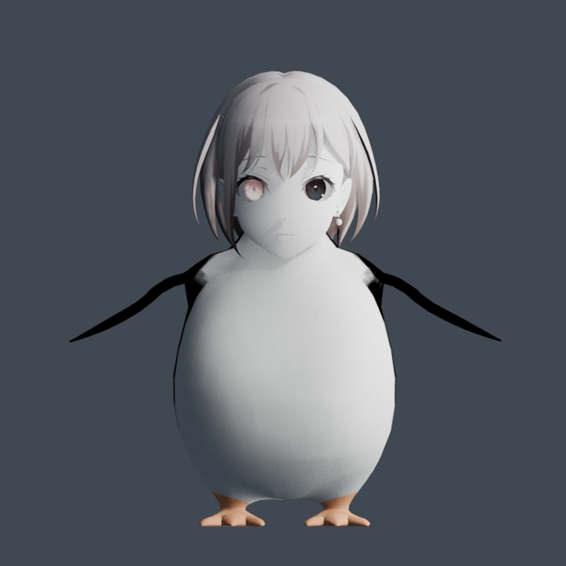
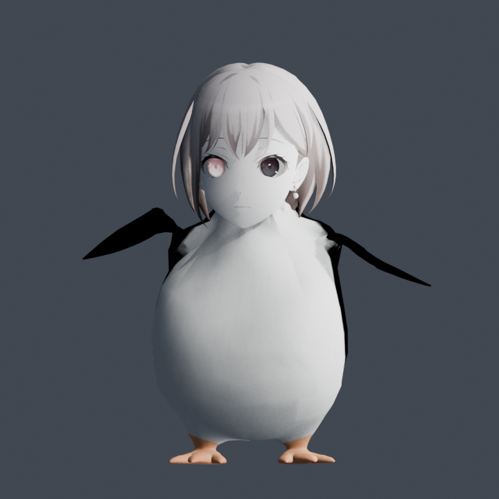

# 企鹅高松灯 / Penguin Tomori — GTA:SA 皮肤模组（.dff + .txd）

把 Blender 版「企鹅高松灯」（企鹅身体 + 高松灯头部）转换成 GTA:SA 可用的 ped 皮肤，
同时提供 **服务器版**（open.mp / SA-MP 0.3.DL 自定义皮肤）和 **本地版**（替换原生皮肤 2 `maccer`）。





---

## 一、下载

| 包 | 用途 | 链接 |
|---|---|---|
| 服务器版 | open.mp / SA-MP 0.3.DL 服务器注册自定义皮肤 | [assets/OSRP_Tomori_Server_Mod.zip](assets/OSRP_Tomori_Server_Mod.zip) |
| 本地版 | 单机 / 客户端本地替换皮肤 **2**（`maccer`） | [assets/Tomori_Local_Replace_2.zip](assets/Tomori_Local_Replace_2.zip) |

详细中文说明：`docs/server-install.txt`、`docs/local-install.txt`
皮肤 ID → 模型名对照表（全部 312 个）：`docs/skin_id_model_map.txt`

---

## 二、服务器版（3 步）

1. 把 `tomori.dff`、`tomori.txd` 放进服务端 `models/` 目录
2. 在 `models/artconfig.txt` 加一行：
   ```
   AddCharModel(2, 20363, "tomori.dff", "tomori.txd");
   ```
3. 重启服务端，脚本里 `SetPlayerSkin(playerid, 20363);`

- 新皮肤 ID：**20363**（未占用区间，可自行改成 20000–29999 内其他未占用 ID）
- 基础皮肤 2（`maccer`），决定动画骨架；改成 `0` 即用 CJ 骨架
- `artconfig.txt` 需 LF 换行、无 BOM
- 客户端首次进服会从 artwork 端口自动下载 models（记得放通 7777/TCP 或对应端口）

---

## 三、本地版（替换皮肤 2）

包内文件已按皮肤 2 的真实模型名命名：`maccer.dff` / `maccer.txd`。

- **方法 A（推荐）**：装 `modloader.asi`，把 `maccer.dff`、`maccer.txd` 丢进游戏根目录 `modloader/`
- **方法 B**：用 Alci's IMG Editor / IMG Tool 打开 `models/gta3.img`，替换同名条目（先备份）

**换成任意角色 ID**：查 `docs/skin_id_model_map.txt` 得到该 ID 的模型名，把企鹅的 dff/txd 重命名成该名字即可，可同时放多份。

> 本地替换只影响自己客户端；20000 以上的服务器自定义皮肤无法本地替换。

---

## 四、技术说明

- 32 根标准 ped 骨骼（名称带前导空格，如 `" Head"`、`" Spine1"`、`" R Hand"`），与基准 ped `WM1.dff` 骨架一致
- 网格：5,391 顶点 / 10,151 面，单材质，1024×1024 烘焙贴图（纹理名 `tomori`）
- 高度对齐基准 ped（1.93），坐标轴由 Blender Z-up 映射为 ped 轴向（X=上 / Y=前 / Z=左右）
- 头部（`Tomori_mesh`）按 `" Spine1"` 摆正居中；翅膀（手臂组）重映射到
  `" L UpperArm"` / `" L ForeArm"` / `" L Hand"` 及右侧同名骨骼，随手臂摆动、武器跟手
- 翅膀姿态：绕肩旋转 + 按躯干轮廓顶出体表 + 整体外扩（`WING_SCALE` / `PR_MARGIN` / `WING_OUT`），
  位移场在翅膀网格上做 8 次拉普拉斯平滑，避免肩部折痕
- 贴图提亮：gamma 0.58 + ×1.15，材质 Base Color 置 1.0，解决游戏内偏暗
- 已移除全部顶点色层，避免 SA 把黑色顶点色当作 prelight 导致模型发暗
- 权重仅保留前 4 影响并归一化
- 构建脚本：`source/build_tomori.py`（Blender 5.0 + DragonFF），产出工程 `source/tomori_ped.blend`

---

## 五、许可（开源 · 禁止商用）

- 本项目（转换后的 dff/txd、脚本、文档）以 **CC BY-NC 4.0** 发布：可自由使用、修改、转载，**禁止商业用途**，转载需署名并保留本仓库链接。
- 原始 Blender 模型 `企鹅高松灯.blend`（含 `mesh0` 企鹅身体 + `Tomori_mesh` 头部）由项目作者提供使用，原文件未标注作者信息。
- 角色「高松灯」及其形象版权归其原作者 / 版权方所有，本仓库不声称拥有该角色版权。
- 完整条款见 [LICENSE](LICENSE)，第三方署名见 [NOTICE.md](NOTICE.md)。

---

## 六、免责声明

本项目仅供学习与个人 / 非商业服务器使用。使用者需自行确认所在服务器与游戏的使用条款；
作者不对因使用本资源导致的任何账号、服务器或版权问题负责。
